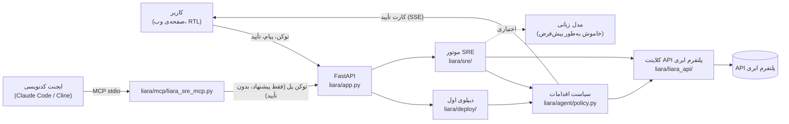

# دستیار دیپلوی و SRE پلتفرم ابری

دستیاری برای برنامه‌نویسی که کدش آماده است ولی بلد نیست آنلاینش کند یا وقتی سایتش خطا می‌دهد، نمی‌داند از کجا شروع کند.
دستیار با **توکن API خود کاربر** به حساب پلتفرم ابری‌اش وصل می‌شود و این کارها را انجام می‌دهد:

- **دیپلوی اول:** فایل zip پروژه را می‌گیرد، نوع پروژه و پلن مناسب (با قیمت) را می‌گوید و با تأیید کاربر برنامه را می‌سازد. بعد بیلد می‌کند و از روی لاگ‌ها می‌فهمد چرا بالا نیامده. خطای شناخته‌شده را درست می‌کند و دوباره بیلد می‌کند (حداکثر ۳ بار)، تا وقتی سایت واقعاً جواب ۲۰۰ بدهد.
- **نگهداری:** کاربر مشکل را به زبان خودش می‌گوید («صفحه‌ی پرداخت خطا می‌ده»، «سایتم کند شده»). دستیار شواهد را از پلتفرم ابری جمع می‌کند (لاگ، رویدادها، مصرف RAM/CPU، نسخه‌ها، تنظیمات) و همزمان سایت را خودش بررسی می‌کند. علت‌های محتمل را با درصد اطمینان رتبه‌بندی می‌کند، یک راه‌حل پیشنهاد می‌دهد و بعد از اجرا با عدد قبل و بعد نشان می‌دهد که مشکل واقعاً حل شده یا نه.
- **کار با ایجنت کدنویسی:** اگر مشکل در کد باشد، ایجنت کدنویسی کاربر (Claude Code، Cline و …) از طریق MCP وصل می‌شود. فایل و خط مقصر را می‌گیرد، کد را درست می‌کند و نسخه‌ی تازه را می‌فرستد. **ولی تأیید همیشه فقط از صفحه‌ی دستیار و با دست کاربر است.**
- **دامنه:** دامنه را به برنامه وصل می‌کند و رکوردهایی را که پلتفرم ابری می‌خواهد نشان می‌دهد. برای ایرنیک قدم‌به‌قدم راهنمایی می‌کند و بعد از تأیید DNS، گواهی SSL می‌گیرد.
- **دیپلوی خودکار (CI/CD):** فایل GitHub Actions مستند پلتفرم ابری را برای همان برنامه می‌سازد (از صفحه یا ابزار MCP `ci_setup`). کلید پلتفرم ابری فقط در secret گیت‌هاب می‌ماند و هیچ‌وقت از دست دستیار رد نمی‌شود. «انتشار بدون قطعی» را هم با یک کارت تأیید روشن می‌کند.

> **بدون حساب پلتفرم ابری امتحانش کنید:** `uv run --frozen python -m liara.dev_server` یک «نسخه‌ی نمایشی» بالا می‌آورد. سه برنامه دارد که از پلتفرم ابری واقعی ضبط شده‌اند: متغیر جاافتاده، باگ کد و نشت حافظه. هر متنی به‌جای کلید کار می‌کند، و تشخیص‌ها همان‌هایی‌اند که روی پلتفرم ابری دیدیم (جزئیات در «اجرا»).

> همه‌ی این مسیرها روی پلتفرم ابری واقعی اجرا شده‌اند؛ پایین‌تر در «سناریوهای واقعی» آمده‌اند.

---

## ۱. مستندات کوتاه معماری



| بخش | مسیر | کار |
|---|---|---|
| کلاینت پلتفرم ابری | `liara/liara_api/` | کلاینت async روی HTTP API پلتفرم ابری، با مدل‌های تایپ‌شده، پیام خطای فارسی، `teamID` روی همه‌ی درخواست‌ها و بسته‌بندی کد به سبک `.gitignore`. حالت REPLAY پاسخ‌های ضبط‌شده را برای تست و نسخه‌ی نمایشی برمی‌گرداند (`DemoReplay`: سه برنامه‌ی ضبط‌شده، فقط‌خواندنی). |
| سیاست اقدامات | `liara/agent/` | تنها راه رسیدن از «ایجنت می‌خواهد X کند» به یک تغییر روی پلتفرم ابری. سطح‌بندی T0 تا T3، کارت تأیید فارسی (ریسک، هزینه، قطعی، راه برگشت، «چطور می‌فهمم درست شد؟»)، سقف هزینه، کلید توقف، حذف رمزها از همه‌ی خروجی‌ها و لاگ append-only. |
| دیپلوی اول | `liara/deploy/` | `analyze.py`: تشخیص نوع پروژه (Flask/Django/FastAPI/Node/Next/SPA/استاتیک/Docker)، متغیرهای محیطی، دیتابیس و پیشنهاد پلن. `heal.py`: فهرست خطاهای شناخته‌شده. `flow.py`: حلقه‌ی بیلد ← مشاهده ← درمان. `ci.py`: فایل GitHub Actions. `domain.py`: کارت دامنه. |
| موتور SRE | `liara/sre/` | `collect.py`: جمع‌آوری موازی شواهد و «دفتر شواهد». `patterns.py`: الگوهای قاعده‌محور P1 تا P10 (پایین‌تر). `llm_jobs.py`: کارهای اختیاری مدل زبانی با اعتبارسنجی. `verify.py`: بررسی قبل و بعد. `capabilities.py`: فهرست کارهایی که API پلتفرم ابری نمی‌تواند انجام دهد. |
| پل MCP | `liara/mcp/` | سرور stdio بدون وابستگی، با ابزارهای `pair`، `troubleshoot`، `deploy_project`، `wait_for_approval`، `verify_fix`، `ci_setup`، `check_capability` و `support_ticket`. **ابزار تأیید ندارد.** |
| صفحه | `liara/web/` | یک صفحه‌ی ساده، بدون منو و تب: کارت خانه (وضعیت، نوار RAM/CPU، قیمت، آخرین نسخه)، چت، برد تشخیص، کارت‌های تأیید، کارت قبل/بعد، دیپلوی اول و دامنه. همه‌ی متن‌ها با `textContent` نوشته می‌شوند (بدون HTML)، با CSP سخت‌گیرانه. |

**الگوهای تشخیص.** هر فرضیه به شاهدهای مشخصی ارجاع می‌دهد. اگر داده‌ی لازمش نباشد، اطمینانش حداکثر ۶۰٪ است.

| کد | الگو |
|---|---|
| P1 | خطای تازه بعد از نسخه‌ی جدید (فایل و خط از traceback) |
| P2 | تنظیمات یا متغیر محیطی جاافتاده |
| P3 / P3u | نشت حافظه / پلن کوچک |
| P4 | پردازنده به سقف رسیده |
| P5 | کرش و بالا آمدن پشت سر هم |
| P6 | کند است ولی منابع آزادند (وابستگی کند؛ ارتقای پلن کمکی نمی‌کند) |
| P7 | نسخه‌ی تازه هنوز در حال بالا آمدن است (۵۰۲/۵۰۳ از دروازه است) |
| P8 | برنامه خاموش یا فریز شده |
| H0 | سالم (با زمان پاسخِ اندازه‌گیری‌شده) |
| P10 | علت روشن نیست؛ گزارش برای پشتیبانی آماده می‌شود |

**هوش.** تشخیص پایه قاعده‌محور و قطعی است و بدون مدل زبانی هم کار می‌کند. اگر `LLM_ENABLED=1` باشد، مدل دو کار را انجام می‌دهد:

- فهم پیام کاربر
- توضیح و رتبه‌بندی دوباره‌ی فرضیه‌ها

خروجی مدل فقط JSON است و اعتبارسنجی می‌شود. مدل نمی‌تواند هیچ اقدامی اجرا کند، و حق ندارد انتخاب اول قاعده‌ها را بیش از ۱۵٪ پایین بیاورد. اگر مدل خاموش باشد، خطا بدهد یا بودجه‌اش تمام شود، همان برد از روی قالب‌ها ساخته می‌شود.

---

## ۲. نحوه‌ی اتصال به APIهای پلتفرم ابری

- **احراز هویت:** کاربر توکن API خودش را در صفحه می‌گذارد. توکن فقط در حافظه‌ی همان نشست سرور نگه داشته می‌شود؛ روی دیسک ذخیره نمی‌شود و در هیچ لاگ، کارت یا پیامی دیده نمی‌شود (Redactor). با بسته شدن یا بیکار ماندن نشست (۳۰ دقیقه) پاک می‌شود.
- **تیم:** اعتبار تیم روی یک تیم است، پس `?teamID=` روی همه‌ی درخواست‌ها فرستاده می‌شود. اگر کاربر فقط یک تیم داشته باشد، همان خودکار انتخاب می‌شود.
- **پایه:** `https://api.liara.ir`، با تلاش دوباره و backoff فقط برای خواندن‌ها. نوشتن‌ها هیچ‌وقت خودکار تکرار نمی‌شوند.

| کار | endpoint | سطح |
|---|---|---|
| پلن‌ها و قیمت | `GET /v1/me` (پلن‌ها و بسته‌ها) | T0 |
| فهرست و جزئیات برنامه | `GET /v1/projects`، `GET /v1/projects/{name}` | T0 |
| لاگ برنامه (به تفکیک نسخه) | `GET /v2/projects/{name}/logs?releaseId=` | T0 |
| رویدادها (start/die/oom/…) | `GET /v1/projects/{name}/events` | T0 |
| مصرف RAM/CPU | `GET /v1/projects/{name}/metrics/summary`، `…/metrics/{cpu,memory}` | T0 |
| نسخه‌ها و لاگ بیلد | `GET /v1/projects/{name}/releases`، `GET /v2/releases/{id}/build-logs` | T0 |
| ساخت برنامه | `POST /v1/projects` (+ `GET/POST /v1/networks`) | **T3** (دو تأیید) |
| ارسال کد و انتشار | `POST /v2/projects/{name}/sources`، `POST /v2/projects/{name}/releases` | T2؛ روی برنامه‌ای که همین دستیار ساخته، ۳ بیلد اول T1 است |
| برگشت به نسخه‌ی قبل | انتشار دوباره‌ی کد ذخیره‌شده‌ی همان نسخه (پلتفرم ابری endpoint بازگشت ندارد) | T2 |
| متغیر محیطی | `POST /v1/projects/update-envs` (خواندن، تغییر، نوشتن کل فهرست) | T2 |
| ری‌استارت / روشن | `POST /v1/projects/{name}/actions/{restart,scale}` | T2 |
| خاموش / تغییر پلن | `…/actions/scale`، `POST /v1/projects/{name}/resize` | **T3** |
| انتشار بدون قطعی | `POST /v1/projects/{id}/zero-downtime/enable` (با `_id` برنامه، نه اسمش). روی بسته‌ی پایه پلتفرم ابری با ۴۲۸ «This plan does not support zero downtime» رد می‌کند (آزموده شد)؛ دستیار این را می‌گوید و دکمه را نشان نمی‌دهد | T2 |
| دامنه و SSL | `POST /v1/domains`، `GET /v1/domains?project=`، `GET /v1/domains/{id}/check`، `POST /v1/domains/provision-ssl-certs` | T2 |

**سطح‌های اقدام** (در کد اعمال می‌شوند، نه در پرامپت):

| سطح | معنی | مثال |
|---|---|---|
| T0 | خواندن؛ خودکار | لاگ، متریک، تشخیص |
| T1 | نوشتن امن؛ خودکار ولی نمایش داده می‌شود | ۳ بیلد اول روی برنامه‌ای که با تأیید کاربر ساخته شده |
| T2 | یک تأیید | دیپلوی، متغیر محیطی، ری‌استارت، دامنه |
| T3 | دو تأیید («انجامش بده» و بعد «مطمئنم») با هزینه و قطعی | ساخت برنامه، تغییر پلن، خاموش کردن |

**قواعد ایمنی کارت تأیید:**

- هر تأیید یک‌بارمصرف است و بعد از ۱۰ دقیقه منقضی می‌شود.
- به هش دقیق آرگومان‌ها گره خورده است.
- فقط از کوکی همان صفحه (SameSite=Strict، بررسی Origin) پذیرفته می‌شود.
- قبل از اجرا بررسی می‌شود که برنامه از وقتی کارت نشان داده شده تغییر نکرده باشد (نسخه، پلن، scale، اثر انگشت متغیرها). اگر تغییر کرده باشد، کارت تازه پیشنهاد می‌شود و هیچ‌وقت کور اجرا نمی‌شود.

**سقف‌ها:**

- ۱۵ دیپلوی و ۳ برنامه‌ی تازه در روز.
- ۱۲ نوشتن در ساعت برای هر نشست.
- ۳ تغییر برای هر مشکل؛ بعد از آن، گزارش برای پشتیبانی آماده می‌شود.

کلید توقف: `LIARA_AGENT_KILL=1` یا فایل `KILL` در پوشه‌ی داده، که همه‌ی نوشتن‌ها را رد می‌کند.

**چیزهایی که روی پلتفرم ابری واقعی دیدیم و طراحی را عوض کرد** (`liara/l0/RESULTS.md`):

- «READY» یعنی بیلد تمام شده، نه اینکه سایت بالا آمده. دستیار بعد از هر بیلد لاگ همان نسخه را می‌خواند و سایت را بررسی می‌کند. «آنلاین» یعنی دو جواب ۲۰۰ به فاصله‌ی ۱۵ ثانیه.
- اگر `envs` در بدنه‌ی انتشار خالی نباشد، کل فهرست متغیرها را **جایگزین** می‌کند. دستیار همیشه `{}` می‌فرستد و متغیرها را جدا تنظیم می‌کند.
- پلتفرم Flask پلتفرم ابری الان با `gunicorn==20.1.0` و setuptools جدید کرش می‌کند (`No module named 'pkg_resources'`). دستیار این را از لاگ می‌شناسد و `setuptools<80` اضافه می‌کند.
- `/v1/billing` اعتبار هدیه را صفر نشان می‌دهد. دستیار آن را فقط راهنما در نظر می‌گیرد و خطای ۴۰۲ را با «شارژ کن» جواب می‌دهد.
- پلتفرم ابری آمار زمان پاسخ نمی‌دهد، پس دستیار خودش سایت را بررسی می‌کند: اول یک درخواست گرم‌کننده، بعد ۵ درخواست پشت سر هم روی همان اتصال. درخواست‌های موازی هر کدام دست‌دهی TLS جدا داشتند و یک صفحه‌ی ۰٫۱ ثانیه‌ای را ۳ ثانیه نشان می‌دادند (یعنی «کند» اشتباه).

**CI/CD و فایل‌های پیکربندی** (بر اساس مستندات و کد CLI پلتفرم ابری؛ جزئیات در منابع پروژه):

- فایل GitHub Actions همان روش مستند پلتفرم ابریست: `npm i -g @liara/cli@9` و `liara deploy --app=… --port=… --team-id=… --api-token="$LIARA_TOKEN" --no-app-logs`.
  - بدون `--detach`، تا نتیجه‌ی بیلد صبر می‌کند و اگر انتشار خراب شود، کار CI قرمز می‌شود.
  - `--no-app-logs` جلوی تمام نشدن کار را می‌گیرد.
  - کلید فقط از secret با اسم `LIARA_API_TOKEN` خوانده می‌شود.
- `liara.json` فقط کلیدهای `platform`، `app`، `port`، `build` و بلوک همان پلتفرم را دارد (مثلاً `flask.appModule`). **هیچ‌وقت `envs` در آن نمی‌نویسیم**، چون همه‌ی متغیرهای برنامه را جایگزین می‌کند.
- اتصال مستقیم گیت‌هاب برای دیپلوی خودکار در پلتفرم ابری فقط از کنسول ممکن است، نه API. دستیار این را صریح می‌گوید و قدم‌هایش را می‌دهد (`github_autodeploy`).

---

## ۳. محدودیت‌های راهکار

دستیار این محدودیت‌ها را هر جا لازم باشد به خود کاربر هم می‌گوید (`liara/sre/capabilities.py`)، به‌جای اینکه وانمود کند کاری را انجام داده:

| مورد | وضعیت در API | دستیار چه می‌کند |
|---|---|---|
| شارژ حساب | ندارد | قدم‌های کنسول را می‌گوید، بعد «انجام دادم» دوباره بررسی می‌کند |
| موجودی دقیق | ناقص (اعتبار هدیه را نشان نمی‌دهد) | عدد را تخمینی اعلام می‌کند و به کنسول ارجاع می‌دهد |
| بازگشت به نسخه‌ی قبل | endpoint ندارد | فقط نسخه‌هایی را برمی‌گرداند که خودش منتشر کرده؛ بقیه از کنسول |
| تغییر بسته (برنزی/نقره‌ای/…) | ندارد | قدم‌های کنسول |
| روشن کردن برنامه‌ی فریزشده | پیدا نشد | قدم‌های کنسول |
| تنظیم DNS در ایرنیک یا ثبت‌کننده | بیرون از پلتفرم ابری | رکوردهای دقیق از جواب پلتفرم ابری و راهنمای ایرنیک (با برچسب «راهنمای خود ما») |
| انتشار بدون قطعی روی بسته‌ی پایه | ندارد (پلتفرم ابری رد می‌کند) | می‌گوید که فقط با ارتقای بسته از کنسول ممکن است |
| اتصال گیت‌هاب برای دیپلوی خودکار | فقط کنسول | فایل GitHub Actions می‌سازد، یا قدم‌های کنسول را می‌گوید |
| آمار کد وضعیت و زمان پاسخ | ندارد | از بررسی خود دستیار و لاگ برنامه تخمین می‌زند و این را می‌گوید |
| هشدار و وب‌هوک | ندارد | پایش ۲۴ ساعته نداریم؛ بررسی وقتی است که کاربر بپرسد یا «الان بررسی کن» را بزند |

**محدودیت‌های خود راهکار:**

- **فهرست درمان‌های خودکار عمداً کوتاه است:**
  - کرش `pkg_resources`
  - پکیج جاافتاده، فقط از فهرست پکیج‌های شناخته‌شده؛ اسم ناشناخته یا فایل خود پروژه هیچ‌وقت خودکار نصب نمی‌شود
  - اسکریپت `start` در Node
  - `appModule` در Flask
  - خطای ناشناخته با پیشنهاد کار بعدی متوقف می‌شود.
- **دیپلوی اول:**
  - فقط از zip، تا ۵۰ مگابایت؛ اتصال به گیت‌هاب ساخته نشده.
  - ساخت دیتابیس خودکار نیست؛ اگر پروژه دیتابیس بخواهد، فقط هشدار داده می‌شود.
- **نشست:**
  - توکن در حافظه است. با ری‌استارت سرور، کاربر باید دوباره وصل شود و ایجنت کدنویسی دوباره جفت شود.
  - کارت‌های در انتظار هم پاک می‌شوند و صفحه این را صریح می‌گوید.
- **دامنه:**
  - روی پلتفرم ابری واقعی هنوز با دامنه‌ی واقعی آزموده نشده.
  - اسم رکورد TXT در مستندات پلتفرم ابری دقیق نیامده؛ کارت می‌گوید «اگر کنسول اسم دیگری گفت، همان درست است».
- **health check پلتفرم ابری:** هنوز روی انتشارها تنظیم نمی‌شود. واحد زمان‌هایش در مستندات پلتفرم ابری ضدونقیض است (میلی‌ثانیه یا ثانیه) و یک آزمایش زنده لازم دارد. فعلاً سلامت را خود دستیار بعد از هر انتشار بررسی می‌کند.
- **نسخه‌ی نمایشی:** فقط‌خواندنی است. تشخیص‌ها از ضبط واقعی می‌آیند، ولی هر تغییری (تأیید کارت) با پیام «این نمایش ضبط‌شده است» رد می‌شود.
- **مدل زبانی:** به‌طور پیش‌فرض خاموش است، تا بدون اجازه‌ی صریح اعتباری خرج نشود. بدون آن، توضیح‌ها از قالب ساخته می‌شوند.
- **مقیاس:** فقط یک سرور و یک پردازه؛ برای یک کاربر یا یک تیم کوچک طراحی شده، نه سرویس عمومی.

---

## ۴. نحوه‌ی تعامل کاربر با سیستم

۱. **وصل شدن:** کاربر در console.liara.ir یک کلید API کوتاه‌مدت می‌سازد و در صفحه می‌گذارد. دستیار تیم را پیدا می‌کند و برنامه‌ها را نشان می‌دهد.

۲. **دیپلوی اول** (باکس «پروژه‌ی تازه رو آنلاین کن»):
   - zip را می‌دهد و کارت تحلیل را می‌بیند: نوع پروژه، روش، پلن پیشنهادی با دلیل و قیمت ماهانه، و چیزهایی که قبل از ارسال درست شده.
   - اسم برنامه را می‌نویسد و «بساز و آنلاین کن» را می‌زند.
   - روی کارت ساخت برنامه دو بار تأیید می‌کند.
   - بعد همه‌چیز زنده جلوی چشمش است: بیلد، «آماده یعنی هنوز معلوم نیست»، کرش از لاگ، تغییری که داده شد (diff)، بیلد دوباره و در آخر «✓ آنلاین شد».
   - در کارت آخر آدرس سایت هست، به‌علاوه‌ی دانلود patch برای مخزن خودش و `liara.json`.

۳. **مشکل در سایت در حال اجرا:**
   - در چت می‌نویسد «صفحه‌ی پرداخت خطا می‌ده». حدود یک ثانیه بعد بردی می‌بیند با یک تیتر، درصد اطمینان، یک «پیشنهاد من» و «چرا؟» (شواهد، علت‌های ردشده، محدودیت‌ها).
   - اگر راه‌حل یک تغییر روی پلتفرم ابری باشد (مثلاً متغیر محیطی جاافتاده)، مقدارش را در فیلد مخفی می‌گذارد و کارت تأیید را می‌بیند.
   - بعد از اجرا، کارت قبل/بعد خودکار می‌آید: کدهای وضعیت، زمان پاسخ، روند حافظه، و یک گزارش ۵ خطی.

۴. **مشکل در کد:**
   - با دکمه‌ی «وصل کردن به ایجنت کدنویسی» یک کد ۶ حرفی می‌گیرد و به Claude Code یا Cline می‌دهد.
   - ایجنت با `troubleshoot` فایل و خط مقصر را می‌گیرد، کد را درست می‌کند و با `deploy_project` نسخه‌ی تازه را می‌فرستد.
   - کاربر کارت انتشار را در صفحه تأیید می‌کند.
   - ایجنت با `verify_fix` نتیجه را می‌گیرد.
   - با `ci_setup` فایل GitHub Actions را در مخزن کاربر می‌نویسد. کاربر فقط کلیدش را خودش به secret گیت‌هاب اضافه می‌کند.
   - راهنمای نصب: `liara/mcp/README.md`.

۵. **دامنه:**
   - «وصل کردن دامنه» را می‌زند، دامنه را می‌نویسد و کارت را تأیید می‌کند.
   - رکوردها را با دکمه‌ی کپی و قدم‌های ایرنیک یا ثبت‌کننده می‌بیند، بعد «انجام دادم، بررسی کن» را می‌زند.
   - وقتی پلتفرم ابری دامنه را تأیید کرد، «گرفتن SSL رایگان» را می‌زند. در آخر بررسی `https://` دامنه نشان داده می‌شود.

۶. **وقتی دستیار نمی‌تواند:** دکمه‌ی «گزارش برای پشتیبانی پلتفرم ابری» یک متن آماده می‌دهد که رمزها و کلیدها از آن حذف شده و شامل مشکل، شواهد و کارهای امتحان‌شده است. همراهش لینک تیکت کنسول هم هست.

---

## سناریوهای واقعی (روی پلتفرم ابری واقعی، ۳۰ مهر ۱۴۰۵ / ۲۲ اکتبر ۲۰۲۶)

| سناریو | نتیجه |
|---|---|
| **دیپلوی اول app D** (Flask، با `main.py` به‌جای `app.py`، بدون `python-dotenv` در requirements) | `appModule: main:app` قبل از ارسال تنظیم شد. بیلد ۱ آماده شد ولی لاگ `No module named 'pkg_resources'` نشان داد، پس `setuptools<80` اضافه شد. بیلد ۲ آماده شد ولی لاگ `No module named 'dotenv'` نشان داد، پس `python-dotenv` اضافه شد. بیلد ۳ آماده شد و دو جواب ۲۰۰ گرفت. در **۳ دقیقه و ۴۸ ثانیه** آنلاین شد: https://dastyar-app-d.liara.run |
| **متغیر محیطی جاافتاده** (demo-shop) | تشخیص در ۰٫۶ ثانیه: P2، `PAYMENT_API_URL`. کاربر مقدار را گذاشت و تأیید کرد. بررسی بعد: `/checkout` از ۵۰۰ به ۲۰۰ رسید، در ۳۹ ثانیه |
| **باگ کد، با Claude Code از طریق MCP** (demo-shop v2) | تشخیص P1 با اطمینان ۰٫۸۵: «server.js خط ۳۷» با TypeError. Claude Code یک خط را درست کرد و با `deploy_project` فرستاد، کاربر تأیید کرد. `verify_fix`: کانتینر تازه، `/checkout` پنج بار ۵۰۰ ← پنج بار ۲۰۰، بدون خطای تازه، حل‌شده در ۹۶ ثانیه |
| **نشت حافظه** (demo-shop v3، ضبط‌شده) | RAM از ۲ به ۴۶۷ مگابایت در ۳٫۵ دقیقه رسید، بعد رویداد `oom`، die و start. برگشت به نسخه‌ی سالم: حافظه ثابت ماند در ۲۴ مگابایت |

---

## اجرا

```bash
cd harbor
uv sync
uv run --frozen python -m liara.dev_server          # نسخه‌ی نمایشی: سه برنامه‌ی ضبط‌شده، بدون حساب و هزینه → http://127.0.0.1:8771
uv run --frozen python -m liara.dev_server --live   # پلتفرم ابری واقعی با کلید API که در صفحه می‌گذارید
uv run --frozen pytest liara/tests -q               # ۱۲۴ تست، همه روی پاسخ‌های ضبط‌شده (بدون هزینه)
uv run --frozen python liara/scripts/stress_symptoms.py   # ۳۹ جمله‌ی مختلف × ۳ برنامه‌ی نمایشی: ۱۱۷ از ۱۱۷ علت درست
uv run --frozen python liara/scripts/stress_healthy.py    # برنامه‌ی سالم × ۱۸ جمله: هیچ علت ساختگی‌ای گفته نمی‌شه
uv run --frozen python liara/scripts/fuzz_routes.py       # ۲۶۷ درخواست خراب به همه‌ی مسیرها: بدون خطای سرور، همه با پیام فارسی
```

متغیرهای اختیاری:

- `LLM_ENABLED=1` همراه با `LLM_PRIMARY_BASE_URL` و `LLM_PRIMARY_API_KEY` (هر API سازگار با OpenAI)
- `LIARA_DEPLOYS_PER_DAY` و `LIARA_APPS_PER_DAY` برای سقف‌ها
- `LIARA_AGENT_KILL=1` برای توقف همه‌ی نوشتن‌ها
- `LIARA_PUBLIC_ORIGIN` وقتی پشت دامنه اجرا می‌شود

در نسخه‌ی نمایشی، هر کدام از این‌ها را در چت بنویسید:

| برنامه | بنویسید | دستیار چه می‌گوید |
|---|---|---|
| `shop-missing-env` | «صفحه‌ی پرداخت خطا می‌ده» | P2 (۸۵٪): بعد از تغییر تنظیمات شروع شد؛ متغیر جاافتاده را تنظیم کن |
| `shop-code-bug` | «صفحه‌ی پرداخت خطا می‌ده» | P1 (۸۰٪): خطا با نسخه‌ی v4 شروع شد، `server.js` خط ۳۷؛ درست کردن کد با ایجنت کدنویسی یا برگشت به v1 |
| `shop-memory-leak` | «سایتم کند شده» | P3 (۸۵٪): نشت حافظه و ری‌استارت از OOM؛ برگشت به نسخه‌ی قبل، و اینکه پلن بزرگ‌تر فقط حدود ۲ ساعت وقت می‌خرد |

برنامه‌های نمونه در `liara/demo-apps/` هستند: demo-shop نسخه‌های ۱ تا ۳ با سه خرابی، و app D برای دیپلوی اول (`app-d.zip`).
