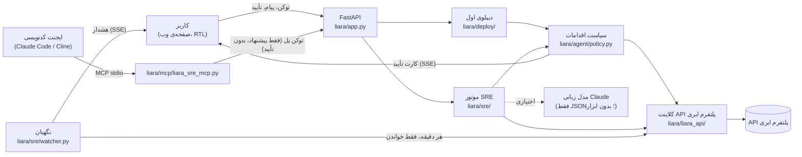

# دستیار دیپلوی و SRE پلتفرم ابری⁤⁤⁤⁤⁤⁤⁤⁤⁤⁣

دستیاری برای برنامه‌نویسی که کدش آماده است ولی بلد نیست آنلاینش کند یا وقتی سایتش خطا می‌دهد، نمی‌داند از کجا شروع کند.
دستیار با **توکن API خود کاربر** به حساب پلتفرم ابری‌اش⁤⁤⁤⁤⁤⁤⁤⁣ وصل می‌شود و این کارها را انجام می‌دهد:

- **دیپلوی اول:** فایل zip پروژه یا لینک مخزن عمومی گیت‌هاب را می‌گیرد، نوع پروژه و پلن مناسب (با قیمت) را می‌گوید و با تأیید کاربر برنامه را می‌سازد. بعد بیلد می‌کند و از روی لاگ‌ها می‌فهمد چرا بالا نیامده. خطای شناخته‌شده را درست می‌کند و دوباره بیلد می‌کند (حداکثر ۳ بار)، تا وقتی سایت واقعاً جواب ۲۰۰ بدهد.
- **نگهداری:** کاربر مشکل را به زبان خودش می‌گوید («صفحه‌ی پرداخت خطا می‌ده»، «سایتم کند شده»). دستیار شواهد را از پلتفرم ابری⁤⁤⁤⁤⁤⁤⁤⁤⁤⁣ جمع می‌کند (لاگ، رویدادها، مصرف RAM/CPU، نسخه‌ها، تنظیمات) و همزمان سایت را خودش بررسی می‌کند. علت‌های محتمل را با درصد اطمینان رتبه‌بندی می‌کند، یک راه‌حل پیشنهاد می‌دهد و بعد از اجرا با عدد قبل و بعد نشان می‌دهد که مشکل واقعاً حل شده یا نه.
- **کار با ایجنت کدنویسی:** اگر مشکل در کد باشد، ایجنت کدنویسی کاربر (Claude Code، Cline و …) از طریق MCP وصل می‌شود. فایل و خط مقصر را می‌گیرد، کد را درست می‌کند و نسخه‌ی تازه را می‌فرستد. **ولی تأیید همیشه فقط از صفحه‌ی دستیار و با دست کاربر است.**
- **نگهبان:** هر دقیقه همه‌ی برنامه‌ها را خودش بررسی می‌کند (جواب سایت، خطاهای ۵xx در لاگ، RAM/CPU نسبت به پلن، ری‌استارت از کمبود حافظه، خاموش بودن) و اگر چیزی خراب شد، همان لحظه در صفحه هشدار می‌دهد و وقتی برطرف شد هم می‌گوید. از هشدار با یک دکمه به تشخیص می‌رسید.
- **دامنه:** دامنه را به برنامه وصل می‌کند و رکوردهایی را که پلتفرم ابری⁤⁤⁤⁤⁤⁤⁤⁤⁤⁣ می‌خواهد نشان می‌دهد. برای ایرنیک قدم‌به‌قدم راهنمایی می‌کند و بعد از تأیید DNS، گواهی SSL می‌گیرد.
- **دیپلوی خودکار (CI/CD):** فایل GitHub Actions مستند پلتفرم ابری⁤⁤⁤⁤⁤⁤⁤⁤⁤⁣ را برای همان برنامه می‌سازد (از صفحه یا ابزار MCP `ci_setup`). کلید پلتفرم ابری⁤⁤⁤⁤⁤⁤⁤⁤⁤⁣ فقط در secret گیت‌هاب می‌ماند و هیچ‌وقت از دست دستیار رد نمی‌شود. «انتشار بدون قطعی» را هم با یک کارت تأیید روشن می‌کند.

> **نسخه‌ی زنده: https://dastyar.frontage.store** و همان کد روی خود پلتفرم ابری⁤⁤⁤⁤⁤⁤⁤⁤⁤⁣: **https://dastyar-sre.liara.run** — کادر کلید را خالی بگذارید و «وصل شو» را بزنید تا نسخه‌ی نمایشی باز شود؛ با کلید API پلتفرم ابری⁤⁤⁤⁤⁤⁤⁤⁤⁣ خودتان، روی حساب واقعی خودتان کار می‌کند.

### برای داوران: ۳ دقیقه، بدون حساب و بدون هزینه

۱. https://dastyar.frontage.store را باز کنید (یا روی سیستم خودتان: پایین‌تر در «اجرا»، یک دستور). کادر کلید را خالی بگذارید و «وصل شو» را بزنید.
۲. سه برنامه‌ی ضبط‌شده از پلتفرم ابری⁤⁤⁤⁤⁤⁤⁤⁤⁣ واقعی می‌بینید. باکس **نگهبان** همان اول سه مشکل را نشان می‌دهد (خطای ۵xx روی `/checkout` در دو برنامه، OOM در سومی).
۳. برنامه‌ی `shop-missing-env` را انتخاب کنید و بنویسید: «صفحه‌ی پرداخت خطا میده». در حدود یک ثانیه برد تشخیص می‌آید: علت (متغیر `PAYMENT_API_URL` بعد از تغییر تنظیمات حذف شده)، درصد اطمینان، «چرا؟» (شواهد با منبع) و **«هوش مصنوعی چه کرد؟»** (پاسخ واقعی Claude که یک بار ضبط شده، کنار جواب قواعد ثابت).
۴. «پیشنهاد من» را بزنید و یک مقدار (مثلاً `https://pay.example.ir/api`) بگذارید. کارت تأیید می‌آید: ریسک، هزینه، قطعی، راه برگشت و «چطور می‌فهمم درست شد؟». **شما انسانِ این حلقه‌اید:** تا «تأیید» را نزنید هیچ اتفاقی نمی‌افتد.
۵. بعد از تأیید، کارت قبل/بعد خودکار می‌آید: `/checkout` از ۵۰۰ به ۲۰۰، بدون خطای تازه در لاگ، و گزارش ۵ خطی. نگهبان هم «برطرف شد» می‌گوید.
۶. همین را با `shop-code-bug` («صفحه‌ی پرداخت خطا میده»؛ فایل و خط مقصر، و «برگشت به نسخه‌ی v1») و `shop-memory-leak` («سایت هی قطع میشه»؛ روند حافظه قبل و بعد) امتحان کنید.

> **صادقانه:** در نسخه‌ی نمایشی تغییر فقط شبیه‌سازی می‌شود و روی کارت و نتیجه نوشته شده. جواب پلتفرم ابری⁤⁤⁤⁤⁤⁤⁤⁤⁤⁣ به همان درخواست و وضعیت «بعد» از ضبط واقعی همان فروشگاه روی پلتفرم ابری⁤⁤⁤⁤⁤⁤⁤⁤⁤⁣ بعد از همان نوع تعمیر می‌آیند، و بررسی قبل/بعد همان کد واقعی `verify.py` است که روی این ضبط اجرا می‌شود. همه‌ی مسیرها روی پلتفرم ابری⁤⁤⁤⁤⁤⁤⁤⁤⁣ واقعی هم اجرا شده‌اند (پایین‌تر: «سناریوهای واقعی»).

### انسان در حلقه (در کد اعمال می‌شود، نه در پرامپت)

- هر تغییر روی پلتفرم ابری⁤⁤⁤⁤⁤⁤⁤⁤⁤⁣ یک کارت تأیید دارد: یک تأیید (T2) یا دو تأیید جدا (T3، برای هر چیزی که هزینه یا قطعی دارد).
- تأیید **فقط** از صفحه‌ی خود کاربر پذیرفته می‌شود (کوکی همان نشست + بررسی Origin). ایجنت کدنویسی (MCP) و مدل زبانی فقط می‌توانند پیشنهاد بدهند: `AgentPort` در `liara/agent/policy.py` اصلاً متد تأیید ندارد و ابزار MCP برای تأیید وجود ندارد.
- تأیید به هش دقیق آرگومان‌ها گره خورده، یک‌بارمصرف است، ۱۰ دقیقه اعتبار دارد و اگر برنامه بعد از دیدن کارت عوض شده باشد اجرا نمی‌شود.

---

## ۱. مستندات کوتاه معماری



| بخش | مسیر | کار |
|---|---|---|
| کلاینت پلتفرم ابری⁤⁤⁤⁤⁤⁤⁤⁤⁤⁣ | `liara/liara_api/` | کلاینت async روی HTTP API پلتفرم ابری⁤⁤⁤⁤⁤⁤⁤⁤⁤⁣، با مدل‌های تایپ‌شده، پیام خطای فارسی، `teamID` روی همه‌ی درخواست‌ها و بسته‌بندی کد به سبک `.gitignore`. حالت REPLAY پاسخ‌های ضبط‌شده را برای تست و نسخه‌ی نمایشی برمی‌گرداند (`DemoReplay`: سه برنامه‌ی ضبط‌شده، فقط‌خواندنی). |
| سیاست اقدامات | `liara/agent/` | تنها راه رسیدن از «ایجنت می‌خواهد X کند» به یک تغییر روی پلتفرم ابری⁤⁤⁤⁤⁤⁤⁤⁤⁤⁣. سطح‌بندی T0 تا T3، کارت تأیید فارسی (ریسک، هزینه، قطعی، راه برگشت، «چطور می‌فهمم درست شد؟»)، سقف هزینه، کلید توقف، حذف رمزها از همه‌ی خروجی‌ها و لاگ append-only. |
| دیپلوی اول | `liara/deploy/` | `analyze.py`: تشخیص نوع پروژه (Flask/Django/FastAPI/Node/Next/SPA/استاتیک/Docker)، متغیرهای محیطی، دیتابیس و پیشنهاد پلن. `heal.py`: فهرست خطاهای شناخته‌شده. `flow.py`: حلقه‌ی بیلد ← مشاهده ← درمان. `ci.py`: فایل GitHub Actions. `domain.py`: کارت دامنه. |
| موتور SRE | `liara/sre/` | `collect.py`: جمع‌آوری موازی شواهد و «دفتر شواهد». `patterns.py`: الگوهای قاعده‌محور P1 تا P10 (پایین‌تر). `llm_jobs.py`: کارهای اختیاری مدل زبانی با اعتبارسنجی. `verify.py`: بررسی قبل و بعد. `capabilities.py`: فهرست کارهایی که API پلتفرم ابری⁤⁤⁤⁤⁤⁤⁤⁤⁤⁣ نمی‌تواند انجام دهد. |
| پل MCP | `liara/mcp/` | سرور stdio بدون وابستگی، با ابزارهای `pair`، `troubleshoot`، `deploy_project`، `wait_for_approval`، `verify_fix`، `ci_setup`، `check_capability` و `support_ticket`. **ابزار تأیید ندارد.** |
| نگهبان | `liara/sre/watcher.py` | حلقه‌ی پس‌زمینه برای هر نشست: هر دقیقه سلامت و منابع همه‌ی برنامه‌ها (تا ۵ تا)، هشدار یک‌بار هنگام شروع مشکل و یک‌بار هنگام رفعش. خطای خواندن «برطرف شد» حساب نمی‌شود. در نسخه‌ی خودمیزبان می‌تواند هشدار را به بله یا تلگرام هم بفرستد. |
| میزبانی | `main.py`، `deploy/vps/`، `liara.json` | یک نقطه‌ی شروع برای پلتفرم ابری⁤⁤⁤⁤⁤⁤⁤⁤⁤⁣ (`python3 main.py`) و سرور: کلید خالی یعنی نسخه‌ی نمایشی، کلید واقعی یعنی نشست زنده روی حساب خود بازدیدکننده. |
| صفحه | `liara/web/` | یک صفحه‌ی ساده، بدون منو و تب: کارت خانه (وضعیت، نوار RAM/CPU، قیمت، آخرین نسخه)، چت، برد تشخیص، کارت‌های تأیید، کارت قبل/بعد، دیپلوی اول و دامنه. همه‌ی متن‌ها با `textContent` نوشته می‌شوند (بدون HTML)، با CSP سخت‌گیرانه. |

**الگوهای تشخیص.** هر فرضیه به شاهدهای مشخصی ارجاع می‌دهد. اگر لاگ برنامه خوانده نشود، اطمینان P1 و P2 حداکثر ۶۰٪ است.

| کد | الگو |
|---|---|
| P1 | خطای تازه بعد از نسخه‌ی جدید (فایل و خط از traceback) |
| P2 | تنظیمات یا متغیر محیطی جاافتاده |
| P3 / P3u | نشت حافظه / پلن کوچک |
| P4 | پردازنده به سقف رسیده |
| P5 | کرش و بالا آمدن پشت سر هم |
| P6 | کند است ولی منابع آزادند (وابستگی کند؛ ارتقای پلن کمکی نمی‌کند) |
| P7 | نسخه‌ی تازه هنوز در حال بالا آمدن است (۵۰۲/۵۰۳ از دروازه است) |
| P8 | برنامه خاموش یا فریز شده |
| H0 | سالم (با زمان پاسخِ اندازه‌گیری‌شده) |
| P10 | علت روشن نیست؛ گزارش برای پشتیبانی آماده می‌شود |

**هوش.** دو لایه با هم کار می‌کنند و برد تشخیص هر دو را کنار هم نشان می‌دهد («هوش مصنوعی چه کرد؟»):

- **قواعد ثابت** (`patterns.py`): از روی شواهد، علت‌ها را با درصد اطمینان پیدا می‌کنند. قطعی‌اند و بدون مدل هم کار می‌کنند.
- **مدل زبانی (Claude Sonnet)** دو کار دارد: (۱) فهم حرف کاربر به زبان خودش (نوع مشکل، صفحه، یک سؤال فقط اگر لازم باشد)؛ (۲) خواندن دفتر شواهد، مرتب کردن دوباره‌ی علت‌ها، اضافه کردن حداکثر یک علت تازه که به دست‌کم دو شاهد واقعی استناد کند، و نوشتن یک جمله‌ی ساده برای کاربر.

خروجی مدل فقط JSON است و اعتبارسنجی می‌شود: استناد به شاهدی که وجود ندارد حذف می‌شود، انتخاب اول قواعد بیش از ۱۵٪ پایین نمی‌آید، و مدل هیچ ابزاری برای تغییر یا تأیید ندارد. لاگ‌ها داخل بلوک «داده‌ی غیرقابل‌اعتماد» به مدل داده می‌شوند. اگر مدل خاموش باشد، خطا بدهد یا بودجه‌اش تمام شود، همان برد از روی قالب‌ها ساخته می‌شود و صفحه می‌گوید «مدل خاموش؛ تشخیص با قواعد».

در نسخه‌ی نمایشی، پاسخ‌های واقعی Claude برای هر سه برنامه **یک بار ضبط شده‌اند** (`liara/scripts/record_llm.py`؛ ۶ فراخوانی، ۵٬۱۹۱ توکن) و با برچسب «پاسخ ضبط‌شده‌ی Claude» پخش می‌شوند، تا هر بازدیدکننده نقش مدل را ببیند بدون هزینه. جمله‌ای غیر از جمله‌ی ضبط‌شده را قواعد می‌خوانند و برد این را می‌گوید.

---

## ۲. نحوه‌ی اتصال به APIهای پلتفرم ابری⁤⁤⁤⁤⁤⁤⁤⁤⁤⁣

- **احراز هویت:** کاربر توکن API خودش را در صفحه می‌گذارد. توکن فقط در حافظه‌ی همان نشست سرور نگه داشته می‌شود؛ روی دیسک ذخیره نمی‌شود و در هیچ لاگ، کارت یا پیامی دیده نمی‌شود (Redactor). با بسته شدن یا بیکار ماندن نشست (۳۰ دقیقه) پاک می‌شود، و حداکثر ۱۲ ساعت حتی با صفحه‌ی باز.
- **تیم:** اعتبار هکاتون روی یک تیم است، پس `?teamID=` روی همه‌ی درخواست‌ها فرستاده می‌شود. اگر کاربر فقط یک تیم داشته باشد، همان خودکار انتخاب می‌شود.
- **پایه:** `https://api.liara.ir`، با تلاش دوباره و backoff فقط برای خواندن‌ها. نوشتن‌ها هیچ‌وقت خودکار تکرار نمی‌شوند.

| کار | endpoint | سطح |
|---|---|---|
| پلن‌ها و قیمت | `GET /v1/me` (پلن‌ها و بسته‌ها) | T0 |
| فهرست و جزئیات برنامه | `GET /v1/projects`، `GET /v1/projects/{name}` | T0 |
| لاگ برنامه (به تفکیک نسخه) | `GET /v2/projects/{name}/logs?releaseId=` | T0 |
| رویدادها (start/die/oom/…) | `GET /v1/projects/{name}/events` | T0 |
| مصرف RAM/CPU | `GET /v1/projects/{name}/metrics/summary`، `…/metrics/{cpu,memory}` | T0 |
| نسخه‌ها و لاگ بیلد | `GET /v1/projects/{name}/releases`، `GET /v2/releases/{id}/build-logs` | T0 |
| ساخت برنامه | `POST /v1/projects` (+ `GET/POST /v1/networks`) | **T3** (دو تأیید) |
| ارسال کد و انتشار | `POST /v2/projects/{name}/sources`، `POST /v2/projects/{name}/releases` | T2؛ روی برنامه‌ای که همین دستیار ساخته، ۳ بیلد اول T1 است |
| برگشت به نسخه‌ی قبل | انتشار دوباره‌ی کد ذخیره‌شده‌ی همان نسخه (پلتفرم ابری⁤⁤⁤⁤⁤⁤⁤⁤⁤⁣ endpoint بازگشت ندارد) | T2 |
| متغیر محیطی | `POST /v1/projects/update-envs` (خواندن، تغییر، نوشتن کل فهرست) | T2 |
| ری‌استارت / روشن | `POST /v1/projects/{name}/actions/{restart,scale}` | T2 |
| خاموش / تغییر پلن | `…/actions/scale`، `POST /v1/projects/{name}/resize` | **T3** |
| انتشار بدون قطعی | `POST /v1/projects/{id}/zero-downtime/enable` (با `_id` برنامه، نه اسمش). روی بسته‌ی پایه پلتفرم ابری⁤⁤⁤⁤⁤⁤⁤⁤⁤⁣ با ۴۲۸ «This plan does not support zero downtime» رد می‌کند (آزموده شد)؛ دستیار این را می‌گوید و دکمه را نشان نمی‌دهد | T2 |
| دامنه و SSL | `POST /v1/domains`، `GET /v1/domains?project=`، `GET /v1/domains/{id}/check`، `POST /v1/domains/provision-ssl-certs` | T2 |

**سطح‌های اقدام** (در کد اعمال می‌شوند، نه در پرامپت):

| سطح | معنی | مثال |
|---|---|---|
| T0 | خواندن؛ خودکار | لاگ، متریک، تشخیص |
| T1 | نوشتن امن؛ خودکار ولی نمایش داده می‌شود | ۳ بیلد اول روی برنامه‌ای که با تأیید کاربر ساخته شده |
| T2 | یک تأیید | دیپلوی، متغیر محیطی، ری‌استارت، دامنه |
| T3 | دو تأیید («انجامش بده» و بعد «مطمئنم») با هزینه و قطعی | ساخت برنامه، تغییر پلن، خاموش کردن |

**قواعد ایمنی کارت تأیید:**

- هر تأیید یک‌بارمصرف است و بعد از ۱۰ دقیقه منقضی می‌شود.
- به هش دقیق آرگومان‌ها گره خورده است.
- فقط از کوکی همان صفحه (SameSite=Strict، بررسی Origin) پذیرفته می‌شود.
- قبل از اجرا بررسی می‌شود که برنامه از وقتی کارت نشان داده شده تغییر نکرده باشد (نسخه، پلن، scale، اثر انگشت متغیرها). اگر تغییر کرده باشد، کارت تازه پیشنهاد می‌شود و هیچ‌وقت کور اجرا نمی‌شود.

**سقف‌ها:**

- ۱۵ دیپلوی و ۳ برنامه‌ی تازه در روز.
- ۱۲ نوشتن در ساعت برای هر نشست.
- ۳ تغییر برای هر مشکل؛ بعد از آن، گزارش برای پشتیبانی آماده می‌شود.

کلید توقف: `LIARA_AGENT_KILL=1` یا فایل `KILL` در پوشه‌ی داده، که همه‌ی نوشتن‌ها را رد می‌کند.

**چیزهایی که روی پلتفرم ابری⁤⁤⁤⁤⁤⁤⁤⁤⁣ واقعی دیدیم و طراحی را عوض کرد** (`liara/l0/RESULTS.md`):

- «READY» یعنی بیلد تمام شده، نه اینکه سایت بالا آمده. دستیار بعد از هر بیلد لاگ همان نسخه را می‌خواند و سایت را بررسی می‌کند. «آنلاین» یعنی دو جواب ۲۰۰ به فاصله‌ی ۱۵ ثانیه.
- اگر `envs` در بدنه‌ی انتشار خالی نباشد، کل فهرست متغیرها را **جایگزین** می‌کند. دستیار همیشه `{}` می‌فرستد و متغیرها را جدا تنظیم می‌کند.
- پلتفرم Flask پلتفرم ابری⁤⁤⁤⁤⁤⁤⁤⁤⁤⁣ الان با `gunicorn==20.1.0` و setuptools جدید کرش می‌کند (`No module named 'pkg_resources'`). دستیار این را از لاگ می‌شناسد و `setuptools<80` اضافه می‌کند.
- `/v1/billing` اعتبار هدیه یا هکاتون را صفر نشان می‌دهد. دستیار آن را فقط راهنما در نظر می‌گیرد و خطای ۴۰۲ را با «شارژ کن» جواب می‌دهد.
- پلتفرم ابری⁤⁤⁤⁤⁤⁤⁤⁤⁤⁣ آمار زمان پاسخ نمی‌دهد، پس دستیار خودش سایت را بررسی می‌کند: اول یک درخواست گرم‌کننده، بعد ۳ تا ۵ درخواست پشت سر هم روی همان اتصال. درخواست‌های موازی هر کدام دست‌دهی TLS جدا داشتند و یک صفحه‌ی ۰٫۱ ثانیه‌ای را ۳ ثانیه نشان می‌دادند (یعنی «کند» اشتباه).

**CI/CD و فایل‌های پیکربندی** (بر اساس مستندات و کد CLI پلتفرم ابری⁤⁤⁤⁤⁤⁤⁤⁤⁤⁣؛ جزئیات در منابع پروژه):

- فایل GitHub Actions همان روش مستند پلتفرم ابری⁤⁤⁤⁤⁤⁤⁤⁤⁤⁣ست: `npm i -g @liara/cli@9` و `liara deploy --app=… --port=… --team-id=… --api-token="$LIARA_TOKEN" --no-app-logs`.
  - بدون `--detach`، تا نتیجه‌ی بیلد صبر می‌کند و اگر انتشار خراب شود، کار CI قرمز می‌شود.
  - `--no-app-logs` جلوی تمام نشدن کار را می‌گیرد.
  - کلید فقط از secret با اسم `LIARA_API_TOKEN` خوانده می‌شود.
- `liara.json` فقط کلیدهای `platform`، `app`، `port`، `build` و بلوک همان پلتفرم را دارد (مثلاً `flask.appModule`). **هیچ‌وقت `envs` در آن نمی‌نویسیم**، چون همه‌ی متغیرهای برنامه را جایگزین می‌کند.
- اتصال مستقیم گیت‌هاب برای دیپلوی خودکار در پلتفرم ابری⁤⁤⁤⁤⁤⁤⁤⁤⁤⁣ فقط از کنسول ممکن است، نه API. دستیار این را صریح می‌گوید و قدم‌هایش را می‌دهد (`github_autodeploy`).

---

## ۳. محدودیت‌های راهکار

دستیار این محدودیت‌ها را هر جا لازم باشد به خود کاربر هم می‌گوید (`liara/sre/capabilities.py`)، به‌جای اینکه وانمود کند کاری را انجام داده:

| مورد | وضعیت در API | دستیار چه می‌کند |
|---|---|---|
| شارژ حساب | ندارد | قدم‌های کنسول را می‌گوید، بعد «انجام دادم» دوباره بررسی می‌کند |
| موجودی دقیق | ناقص (اعتبار هدیه را نشان نمی‌دهد) | عدد را تخمینی اعلام می‌کند و به کنسول ارجاع می‌دهد |
| بازگشت به نسخه‌ی قبل | endpoint ندارد | فقط نسخه‌هایی را برمی‌گرداند که خودش منتشر کرده؛ بقیه از کنسول |
| تغییر بسته (برنزی/نقره‌ای/…) | ندارد | قدم‌های کنسول |
| روشن کردن برنامه‌ی فریزشده | پیدا نشد | قدم‌های کنسول |
| تنظیم DNS در ایرنیک یا ثبت‌کننده | بیرون از پلتفرم ابری⁤⁤⁤⁤⁤⁤⁤⁤⁤⁣ | رکوردهای دقیق از جواب پلتفرم ابری⁤⁤⁤⁤⁤⁤⁤⁤⁤⁣ و راهنمای ایرنیک (با برچسب «راهنمای خود ما») |
| انتشار بدون قطعی روی بسته‌ی پایه | ندارد (پلتفرم ابری⁤⁤⁤⁤⁤⁤⁤⁤⁤⁣ رد می‌کند) | می‌گوید که فقط با ارتقای بسته از کنسول ممکن است |
| اتصال گیت‌هاب برای دیپلوی خودکار | فقط کنسول | فایل GitHub Actions می‌سازد، یا قدم‌های کنسول را می‌گوید |
| آمار کد وضعیت و زمان پاسخ | ندارد | از بررسی خود دستیار و لاگ برنامه تخمین می‌زند و این را می‌گوید |
| هشدار و وب‌هوک | ندارد | نگهبان خود دستیار هر دقیقه بررسی می‌کند، تا وقتی صفحه باز است (کلید فقط در حافظه‌ی نشست است، پس با بسته ماندن صفحه بعد از ۳۰ دقیقه متوقف می‌شود) |

**محدودیت‌های خود راهکار:**

- **فهرست درمان‌های خودکار عمداً کوتاه است:**
  - کرش `pkg_resources`
  - پکیج جاافتاده، فقط از فهرست پکیج‌های شناخته‌شده؛ اسم ناشناخته یا فایل خود پروژه هیچ‌وقت خودکار نصب نمی‌شود
  - اسکریپت `start` در Node
  - پروژه‌ی پایتون با هر دو فایل `requirements.txt` و `pyproject.toml` (پلتفرم ابری⁤⁤⁤⁤⁤⁤⁤⁤⁤⁣ یکی را می‌خواهد؛ وقتی خود دستیار را روی پلتفرم ابری⁤⁤⁤⁤⁤⁤⁤⁤⁤⁣ گذاشتیم دیدیم): `pyproject.toml` با `.liaraignore` از ارسال بیرون می‌ماند
  - `appModule` در Flask
  - خطای ناشناخته با پیشنهاد کار بعدی متوقف می‌شود.
- **دیپلوی اول:**
  - از zip یا لینک مخزن **عمومی** گیت‌هاب، تا ۵۰ مگابایت. برای مخزن خصوصی، zip (دستیار توکن گیت‌هاب نمی‌گیرد).
  - اگر پروژه `liara.json` داشته باشد، پلتفرم و پورتش همان‌طور رعایت می‌شود.
  - ساخت دیتابیس خودکار نیست؛ اگر پروژه دیتابیس بخواهد، فقط هشدار داده می‌شود.
- **نشست:**
  - توکن در حافظه است. با ری‌استارت سرور، کاربر باید دوباره وصل شود و ایجنت کدنویسی دوباره جفت شود.
  - کارت‌های در انتظار هم پاک می‌شوند و صفحه این را صریح می‌گوید.
- **دامنه:**
  - روی پلتفرم ابری⁤⁤⁤⁤⁤⁤⁤⁤⁣ واقعی هنوز با دامنه‌ی واقعی آزموده نشده.
  - اسم رکورد TXT در مستندات پلتفرم ابری⁤⁤⁤⁤⁤⁤⁤⁤⁤⁣ دقیق نیامده؛ کارت می‌گوید «اگر کنسول اسم دیگری گفت، همان درست است».
- **health check پلتفرم ابری⁤⁤⁤⁤⁤⁤⁤⁤⁤⁣:** در `liara.json` دانلودی با همان قالب مستند پلتفرم ابری⁤⁤⁤⁤⁤⁤⁤⁤⁤⁣ گذاشته می‌شود (CLI پلتفرم ابری⁤⁤⁤⁤⁤⁤⁤⁤⁤⁣ آن را با هر `liara deploy` می‌فرستد). روی انتشارهایی که خود دستیار از API می‌فرستد هنوز نه، چون واحد زمان‌ها در API آزموده نشده؛ سلامت را خود دستیار بعد از هر انتشار بررسی می‌کند.
- **نسخه‌ی نمایشی:** فقط راه‌حل ضبط‌شده‌ی هر برنامه اجرا می‌شود (شبیه‌سازی، با برچسب). هر تغییر دیگری با پیام «این نمایش ضبط‌شده است» رد می‌شود، و شمارنده‌های سقف روزانه‌ی حالت زنده دست نمی‌خورند. برای برگشت به حالت خراب، خارج و دوباره وارد شوید.
- **مدل زبانی:** در حالت زنده به‌طور پیش‌فرض خاموش است (`LLM_ENABLED=1` روشنش می‌کند)، تا بدون اجازه‌ی صریح اعتباری خرج نشود. نسخه‌ی عمومی پاسخ‌های ضبط‌شده را نشان می‌دهد.
- **مقیاس:** یک پردازه؛ نشست‌ها در حافظه‌اند. برای یک کاربر یا یک تیم کوچک طراحی شده. نسخه‌ی عمومی برای داوری است.

---

## ۴. نحوه‌ی تعامل کاربر با سیستم

۱. **وصل شدن:** کاربر در console.liara.ir یک کلید API کوتاه‌مدت می‌سازد و در صفحه می‌گذارد. دستیار تیم را پیدا می‌کند و برنامه‌ها را نشان می‌دهد. باکس **نگهبان** از همان لحظه هر دقیقه همه‌ی برنامه‌ها را بررسی می‌کند و هر مشکل تازه را با دکمه‌ی «بررسی کن» در صفحه می‌آورد.

۲. **دیپلوی اول** (باکس «پروژه‌ی تازه رو آنلاین کن»):
   - zip یا لینک مخزن عمومی گیت‌هاب را می‌دهد و کارت تحلیل را می‌بیند: نوع پروژه، روش، پلن پیشنهادی با دلیل و قیمت ماهانه، و چیزهایی که قبل از ارسال درست شده.
   - اسم برنامه را می‌نویسد و «بساز و آنلاین کن» را می‌زند.
   - روی کارت ساخت برنامه دو بار تأیید می‌کند.
   - بعد همه‌چیز زنده جلوی چشمش است: بیلد، «آماده یعنی هنوز معلوم نیست»، کرش از لاگ، تغییری که داده شد (diff)، بیلد دوباره و در آخر «✓ آنلاین شد».
   - در کارت آخر آدرس سایت هست، به‌علاوه‌ی دانلود patch برای مخزن خودش و `liara.json`.

۳. **مشکل در سایت در حال اجرا:**
   - در چت می‌نویسد «صفحه‌ی پرداخت خطا می‌ده». حدود یک ثانیه بعد بردی می‌بیند با یک تیتر، درصد اطمینان، یک «پیشنهاد من» و «چرا؟» (شواهد، علت‌های ردشده، محدودیت‌ها).
   - اگر راه‌حل یک تغییر روی پلتفرم ابری⁤⁤⁤⁤⁤⁤⁤⁤⁤⁣ باشد (مثلاً متغیر محیطی جاافتاده)، مقدارش را در فیلد مخفی می‌گذارد و کارت تأیید را می‌بیند.
   - بعد از اجرا، کارت قبل/بعد خودکار می‌آید: کدهای وضعیت، زمان پاسخ، روند حافظه، و یک گزارش ۵ خطی.

۴. **مشکل در کد:**
   - با دکمه‌ی «وصل کردن به ایجنت کدنویسی» یک کد ۸ حرفی می‌گیرد و به Claude Code یا Cline می‌دهد.
   - ایجنت با `troubleshoot` فایل و خط مقصر را می‌گیرد، کد را درست می‌کند و با `deploy_project` نسخه‌ی تازه را می‌فرستد.
   - کاربر کارت انتشار را در صفحه تأیید می‌کند.
   - ایجنت با `verify_fix` نتیجه را می‌گیرد.
   - با `ci_setup` فایل GitHub Actions را در مخزن کاربر می‌نویسد. کاربر فقط کلیدش را خودش به secret گیت‌هاب اضافه می‌کند.
   - راهنمای نصب: `liara/mcp/README.md`.

۵. **دامنه:**
   - «وصل کردن دامنه» را می‌زند، دامنه را می‌نویسد و کارت را تأیید می‌کند.
   - رکوردها را با دکمه‌ی کپی و قدم‌های ایرنیک یا ثبت‌کننده می‌بیند، بعد «انجام دادم، بررسی کن» را می‌زند.
   - وقتی پلتفرم ابری⁤⁤⁤⁤⁤⁤⁤⁤⁤⁣ دامنه را تأیید کرد، «گرفتن SSL رایگان» را می‌زند. در آخر بررسی `https://` دامنه نشان داده می‌شود.

۶. **وقتی دستیار نمی‌تواند:** دکمه‌ی «گزارش برای پشتیبانی پلتفرم ابری⁤⁤⁤⁤⁤⁤⁤⁤⁤⁣» یک متن آماده می‌دهد که رمزها و کلیدها از آن حذف شده و شامل مشکل، شواهد و کارهای امتحان‌شده است. همراهش لینک تیکت کنسول هم هست.

---

## سناریوهای واقعی (روی پلتفرم ابری⁤⁤⁤⁤⁤⁤⁤⁤⁣ واقعی، ۳۰ مهر ۱۴۰۵ / ۲۲ اکتبر ۲۰۲۶)

| سناریو | نتیجه |
|---|---|
| **دیپلوی اول app D** (Flask، با `main.py` به‌جای `app.py`، بدون `python-dotenv` در requirements) | `appModule: main:app` قبل از ارسال تنظیم شد. بیلد ۱ آماده شد ولی لاگ `No module named 'pkg_resources'` نشان داد، پس `setuptools<80` اضافه شد. بیلد ۲ آماده شد ولی لاگ `No module named 'dotenv'` نشان داد، پس `python-dotenv` اضافه شد. بیلد ۳ آماده شد و دو جواب ۲۰۰ گرفت. در **۳ دقیقه و ۴۸ ثانیه** آنلاین شد: https://dastyar-app-d.liara.run |
| **متغیر محیطی جاافتاده** (demo-shop) | تشخیص در ۰٫۶ ثانیه: P2، `PAYMENT_API_URL`. کاربر مقدار را گذاشت و تأیید کرد. بررسی بعد: `/checkout` از ۵۰۰ به ۲۰۰ رسید، در ۳۹ ثانیه |
| **باگ کد، با Claude Code از طریق MCP** (demo-shop v2) | تشخیص P1 با اطمینان ۰٫۸۵: «server.js خط ۳۷» با TypeError. Claude Code یک خط را درست کرد و با `deploy_project` فرستاد، کاربر تأیید کرد. `verify_fix`: کانتینر تازه، `/checkout` پنج بار ۵۰۰ ← پنج بار ۲۰۰، بدون خطای تازه، حل‌شده در ۹۶ ثانیه |
| **خود دستیار روی پلتفرم ابری⁤⁤⁤⁤⁤⁤⁤⁤⁤⁣** (۱ آبان، با کلاینت خود دستیار: `liara/scripts/host_on_liara.py`) | بیلد ۱ رد شد: «found both requirements.txt and pyproject.toml». همین خطا حالا در فهرست درمان‌هاست (`py-two-manifests`). با `.liaraignore` بیلد ۲ در ۳۷ ثانیه آماده شد و بعد از ۳۰ ثانیه `/health` دو بار ۲۰۰ داد: https://dastyar-sre.liara.run |
| **نشت حافظه** (demo-shop v3، ضبط‌شده) | RAM از ۲ به ۴۶۷ مگابایت در ۳٫۵ دقیقه رسید، بعد رویداد `oom`، die و start. برگشت به نسخه‌ی سالم: حافظه ثابت ماند در ۲۴ مگابایت |

---

## اجرا

```bash
cd harbor
uv sync
uv run --frozen python -m liara.dev_server          # نسخه‌ی نمایشی: سه برنامه‌ی ضبط‌شده، بدون حساب و هزینه → http://127.0.0.1:8771
uv run --frozen python -m liara.dev_server --live   # پلتفرم ابری⁤⁤⁤⁤⁤⁤⁤⁤⁣ واقعی با کلید API که در صفحه می‌گذارید
uv run --frozen pytest liara/tests -q               # ۱۳۵ تست، همه روی پاسخ‌های ضبط‌شده (بدون هزینه)
uv run --frozen python liara/scripts/stress_symptoms.py   # ۳۹ جمله‌ی مختلف × ۳ برنامه‌ی نمایشی: ۱۱۷ از ۱۱۷ علت درست
uv run --frozen python liara/scripts/stress_healthy.py    # برنامه‌ی سالم × ۱۸ جمله: هیچ علت ساختگی‌ای گفته نمی‌شه
uv run --frozen python liara/scripts/fuzz_routes.py       # ۲۶۷ درخواست خراب به همه‌ی مسیرها: بدون خطای سرور، همه با پیام فارسی
```

پیش‌نیاز: [uv](https://docs.astral.sh/uv/) (پایتون ۳.۱۲ را خودش می‌گیرد). از یک کلون تازه: `git clone …/harbor && cd harbor && uv sync && uv run --frozen python -m liara.dev_server`، بعد http://127.0.0.1:8771.

**میزبانی:**

- **پلتفرم ابری⁤⁤⁤⁤⁤⁤⁤⁤⁤⁣:** `liara.json`، `.liaraignore` و `main.py` در ریشه آماده‌اند (پلتفرم python، پورت ۸۰، health check). `liara deploy` کافی است، یا با کلاینت خود دستیار: `uv run --frozen python -m liara.scripts.host_on_liara <اسم>` (همان که https://dastyar-sre.liara.run را ساخت). کلید خالی = نسخه‌ی نمایشی، کلید واقعی = نشست زنده.
- **سرور خودمان** (همان https://dastyar.frontage.store): `sudo bash deploy/vps/setup.sh <پوشه‌ی کد>` یک کاربر سیستمی بدون دسترسی، venv و سرویس systemd سخت‌گیرانه (`deploy/vps/dastyar.service`) می‌سازد؛ تنظیمات در `deploy/vps/dastyar.env.example`. هیچ رمزی لازم نیست: هر بازدیدکننده کلید خودش را می‌آورد.

متغیرهای اختیاری:

- `LLM_ENABLED=1` همراه با `ANTHROPIC_API_KEY` (Claude)، یا `LLM_PRIMARY_BASE_URL` و `LLM_PRIMARY_API_KEY` (هر API سازگار با OpenAI)
- `LIARA_REPLAY=auto` برای میزبانی عمومی (کلید خالی = نمایشی)، `LIARA_WATCH_INTERVAL_S` برای فاصله‌ی نگهبان
- `LIARA_WATCH_PUSH=1` همراه با `BALE_BOT_TOKEN` و `BALE_CHAT_ID` (یا `TELEGRAM_BOT_TOKEN` و `TELEGRAM_CHAT_ID`) برای هشدار نگهبان روی گوشی، فقط در نسخه‌ی خودمیزبان
- `LIARA_WRITES_PER_HOUR` (۱۲ برای هر نشست) و `LIARA_WRITES_PER_HOUR_TOTAL` (۴۰ برای کل سرور)
- `LIARA_MAX_SESSIONS`، `LIARA_MAX_SOURCE_MB` و `LIARA_JOBS_TOTAL` برای سقف حافظه و دیسک در میزبانی عمومی
- `LIARA_DEPLOYS_PER_DAY` و `LIARA_APPS_PER_DAY` برای سقف‌ها
- `LIARA_AGENT_KILL=1` برای توقف همه‌ی نوشتن‌ها
- `LIARA_PUBLIC_ORIGIN` وقتی پشت دامنه اجرا می‌شود

در نسخه‌ی نمایشی، هر کدام از این‌ها را در چت بنویسید:

| برنامه | بنویسید | دستیار چه می‌گوید |
|---|---|---|
| `shop-missing-env` | «صفحه‌ی پرداخت خطا میده» | P2 (۹۰٪): متغیر `PAYMENT_API_URL` بعد از تغییر تنظیمات حذف شده؛ «برگردوندن متغیر جاافتاده» ← تأیید ← `/checkout` از ۵۰۰ به ۲۰۰ |
| `shop-code-bug` | «صفحه‌ی پرداخت خطا میده» | P1 (۸۰٪): خطا با نسخه‌ی v4 شروع شد، `server.js` خط ۳۷؛ درست کردن کد با ایجنت کدنویسی، یا «برگشت به نسخه‌ی v1» ← تأیید ← ۵۰۰ به ۲۰۰ |
| `shop-memory-leak` | «سایت هی قطع میشه» | P3 (۸۵٪): نشت حافظه و ری‌استارت از OOM؛ «برگشت به نسخه‌ی v1» ← تأیید ← روند حافظه از ۷٫۲ به ۰٫۲ مگ در دقیقه؛ پلن بزرگ‌تر فقط حدود ۲ ساعت وقت می‌خرد |

### نقشه‌ی کد: «X کجاست؟»

| دنبال چه هستید | فایل |
|---|---|
| مسیرهای وب، نشست، کوکی و بررسی Origin | `liara/app.py` |
| تنها راه نوشتن روی پلتفرم ابری⁤⁤⁤⁤⁤⁤⁤⁤⁤⁣، کارت تأیید، سقف‌ها، دو تأیید | `liara/agent/policy.py`، `actions.py`، `budget.py` |
| حذف رمزها از همه‌ی خروجی‌ها | `liara/agent/redact.py` |
| تماس با API پلتفرم ابری⁤⁤⁤⁤⁤⁤⁤⁤⁤⁣ و پیام‌های خطای فارسی | `liara/liara_api/client.py`، `errors.py` |
| نسخه‌ی نمایشی (ضبط‌ها، تعمیر شبیه‌سازی‌شده، پاسخ‌های ضبط‌شده‌ی مدل) | `liara/liara_api/replay.py`، `liara/fixtures/demo/` |
| جمع کردن شواهد، الگوهای P1–P10، کار مدل، بررسی قبل/بعد | `liara/sre/collect.py`، `patterns.py`، `llm_jobs.py`، `verify.py`، `engine.py` |
| نگهبان پس‌زمینه | `liara/sre/watcher.py` |
| دیپلوی اول، درمان از روی لاگ، گیت‌هاب، دامنه، CI | `liara/deploy/flow.py`، `heal.py`، `github.py`، `domain.py`، `ci.py` |
| پل ایجنت کدنویسی (MCP، بدون ابزار تأیید) | `liara/mcp/liara_sre_mcp.py` |
| صفحه | `liara/web/index.html`، `app.js`، `app.css` |
| تست‌ها | `liara/tests/` (هر فایل یک موضوع)، و `liara/scripts/stress_*.py`، `fuzz_routes.py` |

برنامه‌های نمونه در `liara/demo-apps/` هستند: demo-shop نسخه‌های ۱ تا ۳ با سه خرابی، و app D برای دیپلوی اول (`app-d.zip`).
